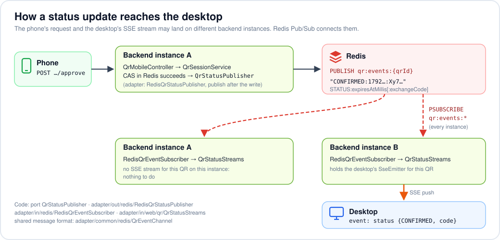

# AdvancedLogin — Architecture & API Design

Status: **v1, all 8 milestones implemented** ([§10](#10-build-order-milestones)). Decisions marked ✅ were the recommendations we went with.
Want to break it? See [§11 *Attack yourself*](#11-attack-yourself). Study guides: [CLEAN_ARCHITECTURE.md](CLEAN_ARCHITECTURE.md),
[SECURITY.md](SECURITY.md) (what's still missing).

---

## 1. Big picture


One React app serves both "screens": the desktop route `/` (QR code when signed out, welcome
when signed in) and the phone routes (`/m/login`, `/m`, `/m/scan`, `/m/approve/:qrId`). One
Spring Boot app serves `/api/**`. In dev, Vite proxies `/api` to Spring, so the browser sees
**one origin** → no CORS, cookies just work. Redis holds everything that has to be shared or
expire: QR sessions, HTTP sessions, rate-limit counters, and the Pub/Sub channel that carries
status updates to whichever instance holds the desktop's SSE stream.

---

## 2. Key decisions

### 2.1 Real-time channel: ✅ SSE (`SseEmitter`), with polling fallback

| | SSE | WebSocket (STOMP) | Polling |
|---|---|---|---|
| Direction needed | server → desktop only ✔ | both (overkill) | client pulls |
| Protocol | plain HTTP, cookies sent automatically | upgrade handshake, STOMP framing | plain HTTP |
| Reconnect | built into `EventSource` | you write it | n/a |
| Spring code | ~30 lines | broker config, destinations, interceptors | trivial |

**Why SSE:** the desktop only ever *listens*. Every action (scan/approve) comes from a
*different* device via normal POSTs. SSE is exactly "one-way push over HTTP".
WebSocket buys bidirectionality we don't use. (Steam/Discord use WebSocket mostly
because they already had a gateway; it's not required by the problem.)

**Design rule — send state snapshots, not deltas.** On every (re)connect the server
first sends the *current* status. If the desktop misses an event during a network
blip, `EventSource` reconnects and gets the truth. This makes the client trivially
correct.

**Scaling note (learning bonus):** an `SseEmitter` lives in one JVM's memory. If you
ever run 2 backend instances, the phone's `approve` may hit instance A while the
desktop's stream is on instance B. Fix: every state change is published to Redis
Pub/Sub channel `qr:events:{qrId}`; each instance forwards to its local emitters.
Built this way from the start, even though dev runs a single instance
([how an update travels](#get-apiqrsessionsqridevents--sse-stream-implemented-in-slice-5)).

### 2.2 Auth model: ✅ server-side sessions (Spring Session + Redis) with HttpOnly cookies

Both the phone web page and the logged-in desktop are *browsers*, so:

- **Cookie `SESSION`** — `HttpOnly; SameSite=Lax` (+ `Secure` behind HTTPS:
  `server.servlet.session.cookie.secure`). JS can't read it → XSS can't steal it.
  Logout = delete server-side session (real revocation, unlike JWT).
- **CSRF protection** is then required for state-changing requests:
  Spring's `CookieCsrfTokenRepository` → React reads `XSRF-TOKEN` cookie and sends
  `X-XSRF-TOKEN` header. (Good thing to learn; JWT-in-header apps skip it.)
- **Session fixation:** on password login *and* on QR exchange, issue a *new* session id.

*When would JWT make sense?* Later, when the phone becomes a native app (React
Native/Flutter) — native apps have no cookie jar convention, so they'd use a
bearer token. The QR module doesn't care: it just asks "who is the authenticated
user?" via `SecurityContext`. We can add a bearer-token filter then.

### 2.3 Users store

In-memory user store (`adapter/out/persistence/InMemoryUserRepository`). With the `dev` profile,
`config/DevUserSeeder` fills it at startup from `app.seed-users` in `application-dev.yml`, hashing
the passwords via the `PasswordHasher` port (BCrypt). Without that profile there are no users.
Swapping to Postgres later = one new `UserRepository` adapter; no use case changes.

---

## 3. State machine


Rules:
- Transitions are **compare-and-set**: "move to SCANNED *only if* currently PENDING".
  Done atomically in Redis with a small **Lua script** (Redis runs scripts
  single-threaded, so two phones scanning simultaneously can't both win).
- Once SCANNED, the session is **locked to that user** (`scannedBy`). Approve/reject
  from any other user → `409`.
- A QR can be scanned **once**. Re-scanning by the same user is idempotent (returns the
  same device info), by a different user → `409`.
- `EXPIRED` is mostly *implicit*: the Redis key disappears. The API reports a missing
  key as `EXPIRED` (we don't distinguish "never existed" from "expired" → no
  information leak).

---

## 4. Full sequence


---

## 5. API

Conventions: JSON, errors as RFC 7807 `application/problem+json`
(Spring's `ProblemDetail`). All IDs/codes are base64url.

### 5.1 Desktop (anonymous)

#### `POST /api/qr/sessions` — create a QR session (implemented in slice 3)
- Anonymous, but CSRF-protected like every POST. Rate-limited per IP (`qr-create`, [§7](#7-rate-limiting)).
- Response `201` + `Location: /api/qr/sessions/{qrId}`:
  ```json
  {
    "qrId": "k3J9…(43 chars)",
    "qrContent": "https://<host>/m/approve/k3J9…",
    "expiresAt": "2026-10-17T12:01:30Z"
  }
  ```
- Also sets cookie `qr_bind=<random 256-bit secret>; HttpOnly; SameSite=Strict; Path=/api/qr; Max-Age=300`
  (+ `Secure` when `app.qr.secure-cookies=true`). Redis stores only `SHA-256(secret)`.
  Max-Age outlives any session (90+60+30s); Redis TTL, not the cookie, decides expiry.
  A new QR overwrites the cookie, so only the newest QR in a browser can complete.
- `qrContent` base URL: `app.qr.approve-base-url` if set, else the desktop request's `Origin`
  (so a desktop opened at `https://<LAN-IP>:5173` produces a link the phone can open), else
  `http://localhost:5173` (`ApproveLinks`). Trusting Origin here only shapes the link shown
  back to the same browser for its own QR.
- Stored atomically by `lua/qr_create.lua` (HSET + PEXPIRE in one script: no key without a TTL).
- Frontend (`useQrLogin`): countdown from the *remaining lifetime* (`expiresAt` − server `Date`
  header) to survive clock skew; auto-refreshes an expired QR 3×, then shows "Reload QR code".

> **Why the binding cookie?** The QR is on screen — anyone near can photograph it.
> `qrId` is therefore *semi-public*. The binding secret never leaves the requesting
> browser (HttpOnly, not in the QR), so only that browser can open the stream or
> redeem the code.

> **Why `qrContent` is an https URL:** if the user scans with the phone's *native*
> camera app it still opens our phone page. Our in-app scanner just parses the id
> out of it.

#### `GET /api/qr/sessions/{qrId}/events` — SSE stream (implemented in slice 5)
- Requires `qr_bind` cookie matching the session → else plain `404` before any stream opens
  (EventSource then gives up, and the frontend falls back to polling, which reports EXPIRED).
- `Content-Type: text/event-stream`. First event is always the current snapshot.
- Events (all `event: status`):
  ```
  data: {"status":"PENDING","expiresAt":"…","serverTime":"…"}
  data: {"status":"SCANNED","expiresAt":"…","serverTime":"…"}
  data: {"status":"CONFIRMED","expiresAt":"…","exchangeCode":"Xy7…","serverTime":"…"}
  data: {"status":"REJECTED","expiresAt":"…","serverTime":"…"}
  data: {"status":"CONSUMED","expiresAt":"…","serverTime":"…"}
  ```
  `serverTime` replaces the `Date` header for clock-skew correction (EventSource hides headers).
- Server closes the stream after a terminal status (REJECTED/CONSUMED). Heartbeat comment
  `: ping` every 15s so proxies don't kill an idle connection.
- Emitter timeout 4 min (longer than any session); EventSource reconnects on its own and gets
  a fresh snapshot (or 404 → expired). Expiry itself isn't pushed: the desktop's countdown
  handles it. (Redis keyspace notifications could push it; not worth the config for now.)
- **Register-then-snapshot:** the controller registers the stream *before* reading the
  snapshot, so an update landing in between is sent twice (harmless) instead of lost.

**How an update travels (works with any number of backend instances):**



Code map: port `application/qr/port/out/QrStatusPublisher` · outbound
`adapter/out/redis/RedisQrStatusPublisher` · inbound `adapter/in/redis/RedisQrEventSubscriber`
· local streams `adapter/in/web/qr/QrStatusStreams` · shared wire format
`adapter/common/redis/QrEventChannel` (the in/out adapters may not import each other) ·
wiring `config/RedisMessagingConfig`. Frontend: port `QrStatusStream`, adapter
`infrastructure/qr/sseQrStatusStream.ts`, fallback in `useQrLogin`.

#### `GET /api/qr/sessions/{qrId}` — status snapshot (implemented in slice 4)
- Requires the `qr_bind` cookie. Response `200 {"status":"SCANNED","expiresAt":"…"}`
  (plus `"exchangeCode"` while CONFIRMED). Missing/wrong cookie, unknown or expired id → `404`
  (the desktop treats it as EXPIRED). Rate-limited per IP together with the stream (`qr-status`).
- The desktop polls it every 2s (`useQrLogin`, `setTimeout` chain so polls never overlap).
  Since slice 5 this is only the fallback: used when the SSE stream can't be (no EventSource,
  or it closed for good).

#### `POST /api/qr/sessions/{qrId}/exchange` — redeem the one-time code (implemented in slice 6)
- Body `{"code":"Xy7…"}` + `qr_bind` cookie (+ CSRF header, like every POST).
- Binding checked first (mismatch → `404`), then the domain's `consume`: status must be
  `CONFIRMED` and the code must match (constant-time) → `CONSUMED` via the same Lua CAS, so
  two racing exchanges can't both win.
- `200 {id, username, displayName}` + new `SESSION` cookie via `WebSessionAuthenticator` (the
  same session handling as password login: new session id, fresh CSRF token); clears `qr_bind`.
- Errors: `404` unknown/expired/not bound (also a replay from the same browser, whose `qr_bind`
  is gone), `409` not approved yet / already redeemed, `400` wrong or missing code.
- Frontend: `useQrLogin` exchanges as soon as `CONFIRMED` arrives (SSE or poll), then
  `auth.refresh()` re-reads `/api/me` and the page re-renders as signed in.

> **Why a code instead of pushing the session directly?** The SSE response body could
> be logged by a proxy, cached, or read by JS. The code is useless on its own
> (single-use, 30s, needs the binding cookie). The real credential (`SESSION`)
> is set by a `Set-Cookie` header JS never sees. Same idea as the OAuth
> *authorization code* flow.

### 5.2 Phone (authenticated, CSRF-protected)

#### Password login (implemented in slice 2)

| Endpoint | Auth | Result |
|---|---|---|
| `GET /api/auth/csrf` | none | `204`; (re)issues the `XSRF-TOKEN` cookie. The SPA calls it before a POST when the cookie is missing |
| `POST /api/auth/login` `{username, password}` | CSRF | `200 {id, username, displayName}` + new `SESSION` cookie; `401` problem+json on bad credentials; `400` on blank fields |
| `GET /api/me` | session | `200 {id, username, displayName}`; `401` when not logged in |
| `POST /api/auth/logout` | session + CSRF | `204`; session deleted from Redis, `XSRF-TOKEN` cleared |

How the pieces fit:
- **CSRF (double-submit cookie):** Spring sets a JS-readable `XSRF-TOKEN` cookie; the SPA copies
  it into the `X-XSRF-TOKEN` header on every non-GET (`infrastructure/http/httpClient.ts`). A
  foreign site can make the browser *send* our cookies but can't *read* them, so it can't forge
  the header. `csrf.spa()` in `SecurityConfig` sets this up.
- **At login** (`WebSessionAuthenticator`, reused later by the QR exchange): new session id
  (defeats session fixation) → rotate CSRF token → save the SecurityContext in the HTTP
  session → Spring Session writes it to Redis under `advancedlogin:session:*`.
- **Timing-safe login:** an unknown username still runs one BCrypt comparison, so response time
  doesn't reveal which usernames exist (`AuthenticateUserService`).
- Test accounts are seeded from `app.seed-users` in `application-dev.yml`, only with the `dev`
  profile (no sign-up flow).

#### `POST /api/qr/sessions/{qrId}/scan` (implemented in slice 4)
- PENDING → SCANNED, locks to current user, TTL reset to 60s (time to decide).
  Re-scan by the same user is idempotent (`200` again).
- Response `200` — **QRLjacking defense**: show the user *what* they're about to log in:
  ```json
  {
    "qrId": "k3J9…",
    "requestedAt": "2026-10-17T12:00:00Z",
    "browser": "Chrome 152",
    "os": "Windows",
    "ipAddress": "203.0.113.7",
    "approximateLocation": "Jakarta, Indonesia",
    "expiresAt": "2026-10-17T12:01:00Z"
  }
  ```
  Browser/OS come from a small User-Agent summarizer (`UserAgentSummary`). The location is
  looked up once at QR creation (`IpLocationLookup` port → `GeoIpLocationLookup`): private/LAN
  IPs → `"Local network"`; public IPs → "City, Country" from an **optional offline** MaxMind-format
  `.mmdb` (`app.geoip.database`; GeoLite2-City or DB-IP City Lite), otherwise omitted. Offline on
  purpose: no third-party request per login. Approximate by nature (VPNs, carrier NAT): a hint
  for the user, never a security decision.
- Errors: `404` expired/unknown, `409` already scanned by someone else.

#### `POST /api/qr/sessions/{qrId}/approve` → `204` (slices 4–6)
SCANNED → CONFIRMED (30s window), only by the user who scanned; anyone else → `409`.
Issues a fresh 256-bit exchange code, pushed to the bound desktop over SSE (and included in the
snapshot for the polling fallback).

#### `POST /api/qr/sessions/{qrId}/reject` → `204` (slice 4)
SCANNED → REJECTED (kept 15s so the desktop can show it), only by the user who scanned.

### 5.3 Error / status code summary

| Situation | Code |
|---|---|
| qrId unknown / expired / wrong binding cookie | `404` (indistinguishable on purpose) |
| Wrong state (e.g. approve while PENDING) or other user | `409` |
| Exchange: not approved yet / already redeemed | `409` |
| Exchange: wrong or missing code | `400` |
| Rate limit hit | `429` + `Retry-After` |
| Not logged in (phone endpoints) | `401` |

---

## 6. Redis key design

| Key | Type | Content | TTL |
|---|---|---|---|
| `qr:s:{qrId}` | HASH | `status`, `bindHash`, `ip`, `userAgent`, `location`, `createdAt`, `expiresAt`, `exchangeCode`, + `scannedBy`, `scannedAt` once scanned | 90s PENDING → 60s after SCANNED → 30s after CONFIRMED → 15s after terminal (so a reconnecting stream still sees the final state) |
| `qr:events:{qrId}` | Pub/Sub channel | `STATUS:expiresAtMillis[:exchangeCode]` on every stored transition | — |
| `rl:{rule}:{subject}` | STRING (counter) | fixed-window counter, `lua/rate_limit.lua` (`INCR` + `PEXPIRE` on first hit); subject = client IP or username | the rule's window (1 min) |
| `advancedlogin:session:*` | managed by Spring Session (`spring.session.data.redis.namespace`) | HTTP sessions | 30 min idle |

Notes:
- **Random values:** `qrId`, bind secret, exchange code = 32 bytes from `SecureRandom`,
  base64url → 43 chars, 256 bits. Unguessable; no need for HMAC signing.
- **Transitions = optimistic concurrency.** `QrSessionService` reads the session, the domain
  (`QrSession.scan/approve/reject`) decides the new state, then `lua/qr_transition.lua` writes it
  *only if* the status is still the one that was read (compare-and-set, new TTL in the same
  step). If the CAS loses a race, the service re-reads once and lets the domain re-decide
  (e.g. the slower of two scanning phones gets `409`). One generic script serves every
  transition; ownership is safe because `scannedBy` is only ever set together with
  PENDING → SCANNED, so "status is still SCANNED" implies "same scanner".
- The exchange code is stored in the hash in plaintext — acceptable because it lives ≤30s,
  is useless without the binding cookie, and is wiped (set to `""`) on CONSUMED. Storing it
  lets a reconnecting stream or a poll re-deliver it. (Stricter alternative: store only a hash
  and deliver the code once; a missed push then means starting over.) It also travels in the
  Pub/Sub payload (`CONFIRMED:<expiresAt>:<code>`), inside the same trusted Redis.

---

## 7. Rate limiting

Implemented in slice 8.

| Rule | Applies to | Limit | Why |
|---|---|---|---|
| `qr-create` | `POST /api/qr/sessions`, per IP | 10/min | stop Redis flooding / QR farming |
| `qr-status` | `GET …/{qrId}` + `…/events`, per IP | 60/min | polling is 30/min; leaves room for SSE reconnects |
| `qr-exchange` | `POST …/exchange`, per IP | 10/min | limit code guessing (256-bit, so belt and braces) |
| `login-ip` | `POST /api/auth/login`, per IP | 20/min | password spraying from one place |
| `login-user` | login, per **username**, from any IP | 5/min | targeted guessing from many IPs |

How:
- `CheckRateLimitUseCase` (application) holds the named rules from `app.rate-limit.rules`, and asks
  the `RateLimiter` port → `RedisRateLimiter` → `lua/rate_limit.lua`. Counters are shared by all
  backend instances; a fixed window per key, starting at the first hit.
- The **per-IP** rules run in `RateLimitFilter`, registered just *before* Spring Security, so a
  flood is turned away before session/CSRF work. The IP is `getRemoteAddr()` after Tomcat's
  `RemoteIpValve`, so a client can't dodge limits by sending its own `X-Forwarded-For`.
- The **per-username** rule runs inside the login use case (`AuthenticateUserService`): it's about
  an account, not a connection, and the username lives in the JSON body. It counts unknown
  usernames too (no account enumeration) and fires *before* the password check.
- `429` + `Retry-After` + problem+json; the frontend shows "Try again in N seconds".
- **Fail open** if Redis is down (logged): rate limiting must not become the outage.
- Trade-offs: a fixed window allows a 2× burst around the boundary (fine here); per-username
  limits let someone lock a known account out for a minute (mild, temporary).

Written by hand on purpose (a nice exercise); Bucket4j would be the library option.

---

## 8. Frontend design

Routes (React Router):

| Route | Who | What |
|---|---|---|
| `/` | desktop | signed out: create session → render QR (`qrcode.react`) → `EventSource` → react to status; auto-refresh QR on EXPIRED (max 3×, then "Reload QR code"). Signed in: "Welcome" + sign out |
| `/status` | any | backend + Redis health |
| `/m/login` | phone | username/password form |
| `/m` | phone | home: "Scan QR code", sign out |
| `/m/scan` | phone | camera scanner (`getUserMedia` + `BarcodeDetector` via the `barcode-detector` ponyfill / ZXing-wasm); accepts only our own approve link (`parseApproveLink`), then navigates to approve; "paste the link" fallback |
| `/m/approve/:qrId` | phone | calls `scan`, shows device/IP/location/time, **Approve / Reject** buttons |

Frontend learning topics this touches: custom hooks (`useQrLogin`: create, SSE with polling
fallback, countdown, exchange), ports + React context for dependency injection, a pure
`applySnapshot` state transition, protected routes (`RequireAuth`), and a fetch wrapper that adds
the CSRF header (`httpClient`).

```ts
// domain/qr/qrSession.ts: mirrors the backend state machine (§3)
type QrStatus = 'PENDING' | 'SCANNED' | 'CONFIRMED' | 'REJECTED' | 'CONSUMED' | 'EXPIRED'

type QrStatusSnapshot = {
  status: QrStatus
  expiresAt?: Date        // already converted to this browser's clock
  exchangeCode?: string   // only with CONFIRMED
}
```

### 8.1 Phone on the LAN (implemented in slice 7)

`getUserMedia` (camera) only works in a *secure context*: `https://`, or `http://localhost`.
A phone reaching your PC via `http://192.168.x.x` is **not** secure, so:

- `bun run dev:lan` = `vite --mode lan`: `@vitejs/plugin-basic-ssl` (self-signed cert) +
  `server.host: true`. The phone shows a certificate warning once; accept it. (`mkcert` with its
  root CA installed on the phone avoids the warning; more setup.)
- LAN mode also sets `hmr: false, ws: false`: Bun crashes on WebSocket upgrades over HTTPS, so
  there's no hot reload there (refresh after a change).
- Open the **desktop** at the printed `https://<LAN-IP>:5173` address too, so the QR link (built
  from the desktop's Origin) is reachable from the phone.
- Vite proxy has `xfwd: true` and Spring `server.forward-headers-strategy: native`: Tomcat's
  `RemoteIpValve` trusts `X-Forwarded-For` **only from internal proxies** (127/8, 10/8,
  192.168/16, …), so the phone's approve screen shows the desktop's real LAN IP.

**Scanner design** (frontend): port `QrCodeScanner` → adapter
`infrastructure/camera/cameraQrCodeScanner.ts` (lazy-loads the decoder and serves the `.wasm` from
our own build, not a CDN) → hook `useQrScanner` → `MobileScanPage`. Two rules worth noticing:

1. **Never navigate to scanned text.** A camera decodes any QR (menus, Wi-Fi configs, phishing
   links). `domain/qr/approveLink.ts` accepts only `<our origin>/m/approve/<43-char id>` and
   extracts the id; everything else is reported as "not an AdvancedLogin QR code".
   Unit-tested with `bun test`.
2. **Release the camera.** Stop all tracks as soon as a code is found or the page unmounts (the
   camera light must go off), and don't start it twice under StrictMode (`queueMicrotask`).

---

## 9. Project structure — clean architecture

Two separate git repos side by side (no repo at the top level). Both follow the same
**dependency rule: source-code dependencies only point inwards.**


- **domain** — business objects and rules (`QrSession`, state transitions). Plain code: no
  framework, no I/O. The most stable layer.
- **application** — use cases (`ScanQrSessionUseCase`, `ApproveQrSessionUseCase`…) and **ports**:
  interfaces for what a use case needs from the outside world (`QrSessionStore`, `QrStatusPublisher`).
- **adapters / infrastructure** — implement the ports with real tech (Redis + Lua, SSE,
  Spring MVC controllers, `fetch`). Replaceable without touching use cases.
- **config / app** — the composition root that wires concrete adapters into use cases.

*Why:* the QR state machine and security rules are the valuable part. Keeping them free of
Spring/Redis/React means they're unit-testable with fakes in milliseconds, and swapping
SSE ↔ WebSocket or Redis ↔ something else only touches an adapter.

The rule is **enforced by the build**, not just by convention:
- backend: ArchUnit test `architecture/CleanArchitectureTest` (fails `mvnw test`)
- frontend: `no-restricted-imports` overrides in `.oxlintrc.json` (fails `bun run lint`)

### Backend (`backend/` — Spring Boot 4.1, Java 21, Maven)

```
backend/
├── docs/                         # design docs (this file, RUNNING, SECURITY, ...) + images/
├── docker-compose.yml            # Redis + RedisInsight, bound to 127.0.0.1, with a password
├── src/main/java/com/advancedlogin/
│   ├── AdvancedLoginApplication.java
│   ├── domain/                   # plain Java, no Spring imports (ArchUnit-checked)
│   │   ├── health/               # HealthStatus, SystemHealth
│   │   ├── user/                 # User, UserId
│   │   └── qr/                   # QrSession (state machine), QrStatus, QrSessionId, BindingHash,
│   │                             # RequestingDevice, QrTimeouts, QrStatusUpdate, exceptions
│   ├── application/              # use cases + ports, no Spring imports (ArchUnit-checked)
│   │   ├── health/               # CheckHealthService, port/in, port/out/DataStoreHealthPort
│   │   ├── auth/                 # AuthenticateUserService, GetUserService,
│   │   │                         # port/out/UserRepository, PasswordHasher
│   │   ├── ratelimit/            # RateLimitService, RateLimit, port/out/RateLimiter
│   │   └── qr/
│   │       ├── port/in/          # Create/Scan/Approve/Reject QrSession, ExchangeQrCode, GetQrSessionStatus
│   │       ├── port/out/         # QrSessionStore, QrStatusPublisher, RandomTokenGenerator, IpLocationLookup
│   │       └── *Service.java     # CreateQrSessionService, QrSessionService
│   ├── adapter/
│   │   ├── in/web/               # ApiExceptionHandler (exceptions → problem+json)
│   │   │   ├── health/           # HealthController
│   │   │   ├── auth/             # AuthController (csrf, login, logout, me)
│   │   │   ├── qr/               # QrDesktopController, QrMobileController, QrStatusStreams (SSE),
│   │   │   │                     # ApproveLinks, UserAgentSummary
│   │   │   ├── ratelimit/        # RateLimitFilter (per-IP rules, before Spring Security)
│   │   │   └── security/         # WebSessionAuthenticator, SessionUser
│   │   ├── in/redis/             # RedisQrEventSubscriber (Pub/Sub → local SSE streams)
│   │   ├── common/redis/         # QrEventChannel (Pub/Sub wire format, shared by in & out)
│   │   └── out/
│   │       ├── redis/            # RedisQrSessionStore (+ Lua), RedisQrStatusPublisher,
│   │       │                     # RedisRateLimiter, RedisDataStoreHealthAdapter
│   │       ├── persistence/      # InMemoryUserRepository
│   │       ├── security/         # SpringPasswordHasher (BCrypt), SecureRandomTokenGenerator
│   │       └── geo/              # GeoIpLocationLookup (optional offline .mmdb)
│   └── config/                   # UseCaseConfig (@Bean wiring), SecurityConfig, RateLimitConfig,
│                                 # RedisMessagingConfig, DevUserSeeder (dev profile only)
└── src/main/resources/
    ├── application.yml           # + application-dev.yml (test accounts, dev Redis password)
    └── lua/                      # qr_create.lua, qr_transition.lua (generic CAS), rate_limit.lua
```

Use-case classes carry **no Spring annotations**; they're registered as `@Bean`s in
`config/UseCaseConfig`. Adapters may use `@Component`/`@RestController` freely.

### Frontend (`frontend/` — Vite + React + TS + Tailwind, bun)

```
frontend/src/
├── domain/                       # plain TS: types + pure logic, no React
│   ├── health/                   # systemHealth
│   ├── user/                     # User
│   └── qr/                       # qrSession (QrStatus, countdown), approveLink (+ test), loginRequest
├── application/                  # use-case hooks + ports (may use React, not infrastructure)
│   ├── ports/                    # HealthGateway, AuthGateway, QrGateway, QrStatusStream,
│   │                             # QrApprovalGateway, QrCodeScanner
│   ├── dependencies.ts           # Dependencies type + context + useDependencies()
│   ├── health/                   # useSystemHealth
│   ├── auth/                     # AuthProvider, authContext, errors
│   └── qr/                       # useQrLogin (desktop), useQrScanner, useQrApproval (phone), errors
├── infrastructure/               # implements ports: fetch, EventSource, camera
│   ├── http/                     # httpClient (CSRF header), serverClock (clock skew)
│   ├── auth/, health/            # httpAuthGateway, httpHealthGateway (DTO → domain)
│   ├── qr/                       # httpQrGateway, httpQrApprovalGateway, sseQrStatusStream
│   └── camera/                   # cameraQrCodeScanner (getUserMedia + ZXing wasm)
├── presentation/                 # React components & pages, talk to hooks only
│   ├── components/               # QrLoginPanel, Countdown, Card, RequireAuth, StatusRow, SystemStatus
│   └── pages/                    # HomePage, StatusPage, MobileLoginPage, MobileHomePage,
│                                 # MobileScanPage, MobileApprovePage
├── app/                          # composition root: DependenciesProvider, App (routes)
└── main.tsx
```

`application/` uses React hooks (pragmatic for React), but never `fetch`/`EventSource`:
those live behind ports, which `app/DependenciesProvider` fills with real implementations
(or fakes in tests).

---

## 10. Build order (milestones)

1. **Skeleton** (done) — docker-compose Redis, Spring Boot app, Vite app, proxy, `/api/health`.
2. **Normal login** (done) — users, `/api/auth/login`, Spring Session in Redis, CSRF, `/m/login`, `/api/me`.
3. **QR create + render** (done) — `POST /api/qr/sessions`, binding cookie, QR on `/` (desktop).
4. **Status via polling** (done) — `GET /api/qr/sessions/{id}`, scan/approve/reject + Lua CAS, `/m/approve/:qrId`.
   End-to-end works with a hard-coded qrId pasted on the phone.
5. **SSE** (done) — replace polling with `EventSource` (polling kept as fallback); Redis pub/sub fan-out.
6. **Exchange** (done) — one-time code → session cookie → desktop logged in.
7. **Phone camera scanner** (done) + HTTPS dev setup (`bun run dev:lan`).
8. **Hardening** (done) — rate limiting, device/IP display, GeoIP, QR auto-refresh, tests
   (Testcontainers Redis), attack-yourself exercises (see [§11](#11-attack-yourself)).

---

## 11. Attack yourself

Every row is an attack on QR login, the defence, the automated test that proves it, and a way
to try it by hand. (Run the app locally; never against systems you don't own.)

| # | Attack | Defence | Proven by | Try it |
|---|---|---|---|---|
| 1 | **Photograph the QR**, open its link in your own browser to watch/steal the login | `qr_bind` HttpOnly cookie; status/stream/exchange need it | `QrApprovalFlowIntegrationTest.knowingTheQrIdIsNotEnoughToWatchIt` | Copy `qrContent` to another browser profile: `GET /api/qr/sessions/{id}` → 404 |
| 2 | **Steal the exchange code** (logs, shoulder) and redeem it | code is useless without `qr_bind` | `QrLoginEndToEndIntegrationTest.stolenCodeIsUselessWithoutTheBindingCookie` | `curl -X POST …/exchange` with the code but no cookie → 404 |
| 3 | **Replay** the code after login | single use (CONSUMED) + `qr_bind` cleared | `…desktopEndsUpLoggedInAsThePhoneUser` (last lines) | POST the same code twice → 404 / 409 |
| 4 | **Race:** two phones scan (or approve) at the same instant | Lua compare-and-set; loser re-reads and gets 409 | `QrApprovalFlowIntegrationTest.whenTwoPhonesScanAtTheSameInstantExactlyOneWins` | Fire two `scan` curls in parallel (`&`) |
| 5 | **Hijack after scan:** another user approves someone else's scan | session locked to `scannedBy` | `QrSessionTest.onlyTheScannerCanApproveOrReject`, `…onceScannedOtherUsersAreLockedOut` | Log in as bob in a third profile, POST `/approve` → 409 |
| 6 | **QRLjacking:** relay *your* QR to a victim ("scan for a prize") | phone shows browser, OS, IP, location, time before approving | `QrApprovalFlowIntegrationTest.happyPathScanThenApprove` (fields present) | Create a QR with a fake `User-Agent` via curl; look at the phone screen |
| 7 | **Malicious QR** pointing the phone to a phishing site | phone only accepts `<own origin>/m/approve/<id>`, never navigates to scanned URLs | `frontend: approveLink.test.ts` | Scan any other QR (or paste a URL) on `/m/scan` |
| 8 | **Guess qrIds / codes** | 256-bit `SecureRandom` ids; rate limits | `RateLimitIntegrationTest` | Loop `GET /api/qr/sessions/<random>` → 404s, then 429 |
| 9 | **Password brute force** on the phone login | per-IP + per-username limits, BCrypt, timing-equalised unknown users | `RateLimitIntegrationTest.passwordGuessingIsLimitedPerUsernameEvenWithTheRightPassword`, `AuthenticateUserServiceTest` | 6 wrong logins in a minute → "Too many sign-in attempts" |
| 10 | **CSRF:** a malicious site makes your phone browser POST `/approve` | `SameSite=Lax` SESSION + `X-XSRF-TOKEN` double-submit | `AuthFlowIntegrationTest.loginWithoutCsrfTokenIsForbidden`, `CreateQrSessionIntegrationTest.creatingRequiresCsrfToken` | `curl` a POST with the SESSION cookie but no header → 403 |
| 11 | **Session fixation:** plant a session id before login | new session id + new CSRF token at login/exchange | `AuthFlowIntegrationTest.fullLoginMeLogoutFlow` (token rotated) | Compare `SESSION` before/after login in DevTools |
| 12 | **Spoof your IP** via `X-Forwarded-For` to dodge limits / fake the phone screen | header only trusted from internal proxies (RemoteIpValve) | `CreateQrSessionIntegrationTest.realClientIpAndOriginComeThroughTheDevProxy` (trusted path) | From another machine, send `X-Forwarded-For: 1.2.3.4` straight to :8080 → ignored |
| 13 | **Stale QR** left on a public screen | 90s TTL, auto-refresh max 3×, then manual | `QrSessionServiceTest.expiredSessionIsNotFoundEvenIfStillStored` | Wait 90s; the old id 404s |

Not covered (out of scope for this project): XSS in the SPA (React escapes by default; add a CSP
in production), TLS/HSTS in production, account recovery, device management ("log out other
sessions"), audit logging.
