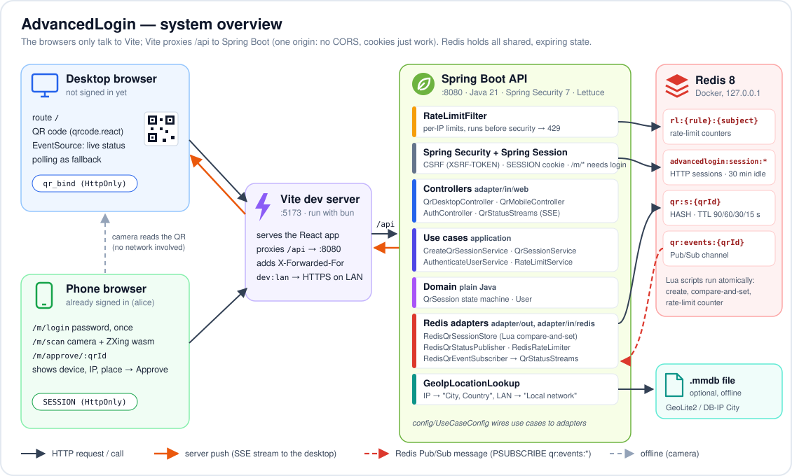
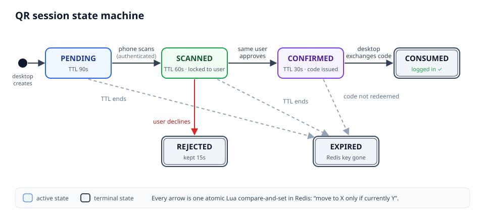
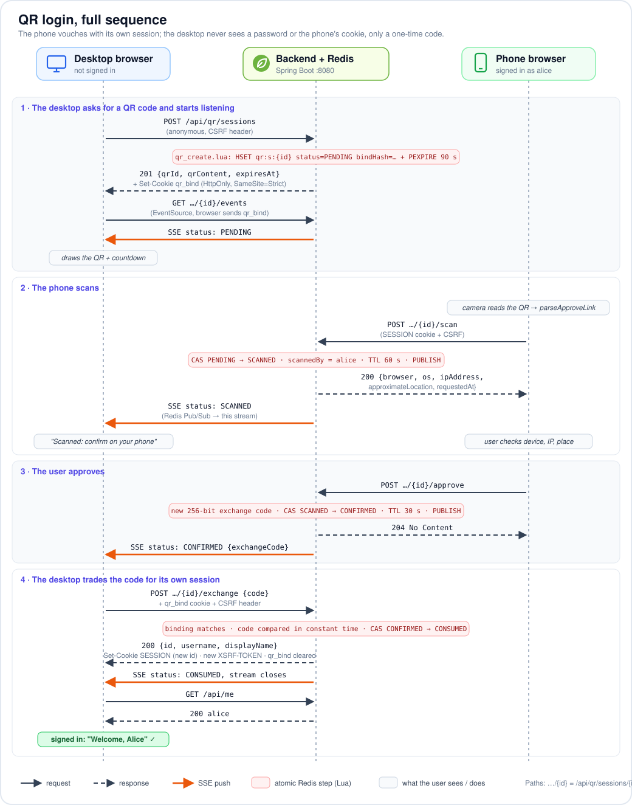

# AdvancedLogin — Architecture & API Design

Status: **draft v1** — decisions marked ✅ are recommendations, open to change.

---

## 1. Big picture



One React app serves both "screens": desktop routes (`/login`, `/`) and phone routes
(`/m/login`, `/m/scan`, `/m/approve/:qrId`). One Spring Boot app serves `/api/**`.
In dev, Vite proxies `/api` to Spring, so the browser sees **one origin** → no CORS,
cookies just work.

---

## 2. Key decisions

### 2.1 Real-time channel: ✅ SSE (`SseEmitter`), with polling fallback

| | SSE | WebSocket (STOMP) | Polling |
|---|---|---|---|
| Direction needed | server → desktop only ✔ | both (overkill) | client pulls |
| Protocol | plain HTTP, cookies sent automatically | upgrade handshake, STOMP framing | plain HTTP |
| Reconnect | built into `EventSource` | you write it | n/a |
| Spring code | ~30 lines | broker config, destinations, interceptors | trivial |

**Why SSE:** the desktop only ever *listens*. Every action (scan/approve) comes from a
*different* device via normal POSTs. SSE is exactly "one-way push over HTTP".
WebSocket buys bidirectionality we don't use. (Steam/Discord use WebSocket mostly
because they already had a gateway; it's not required by the problem.)

**Design rule — send state snapshots, not deltas.** On every (re)connect the server
first sends the *current* status. If the desktop misses an event during a network
blip, `EventSource` reconnects and gets the truth. This makes the client trivially
correct.

**Scaling note (learning bonus):** an `SseEmitter` lives in one JVM's memory. If you
ever run 2 backend instances, the phone's `approve` may hit instance A while the
desktop's stream is on instance B. Fix: every state change is published to Redis
Pub/Sub channel `qr:events:{qrId}`; each instance forwards to its local emitters.
We'll build it this way from day one even with one instance.

### 2.2 Auth model: ✅ server-side sessions (Spring Session + Redis) with HttpOnly cookies

Both the phone web page and the logged-in desktop are *browsers*, so:

- **Cookie `SESSION`** — `HttpOnly; Secure; SameSite=Lax`. JS can't read it → XSS
  can't steal it. Logout = delete server-side session (real revocation, unlike JWT).
- **CSRF protection** is then required for state-changing requests:
  Spring's `CookieCsrfTokenRepository` → React reads `XSRF-TOKEN` cookie and sends
  `X-XSRF-TOKEN` header. (Good thing to learn; JWT-in-header apps skip it.)
- **Session fixation:** on successful QR exchange, issue a *new* session id.

*When would JWT make sense?* Later, when the phone becomes a native app (React
Native/Flutter) — native apps have no cookie jar convention, so they'd use a
bearer token. The QR module doesn't care: it just asks "who is the authenticated
user?" via `SecurityContext`. We can add a bearer-token filter then.

### 2.3 Users store

Start with an in-memory/H2 user table with a couple of seeded users (BCrypt
passwords). Swap to Postgres later — not the focus of this project.

---

## 3. State machine



Rules:
- Transitions are **compare-and-set**: "move to SCANNED *only if* currently PENDING".
  Done atomically in Redis with a small **Lua script** (Redis runs scripts
  single-threaded, so two phones scanning simultaneously can't both win).
- Once SCANNED, the session is **locked to that user** (`scannedBy`). Approve/reject
  from any other user → `409`.
- A QR can be scanned **once**. Re-scanning by the same user is idempotent (returns the
  same device info), by a different user → `409`.
- `EXPIRED` is mostly *implicit*: the Redis key disappears. The API reports a missing
  key as `EXPIRED` (we don't distinguish "never existed" from "expired" → no
  information leak).

---

## 4. Full sequence



---

## 5. API

Conventions: JSON, errors as RFC 7807 `application/problem+json`
(Spring 6 `ProblemDetail`). All IDs/codes are base64url.

### 5.1 Desktop (anonymous)

#### `POST /api/qr/sessions` — create a QR session
- Rate limited per IP (e.g. 10/min).
- Response `201`:
  ```json
  {
    "qrId": "k3J9…(43 chars)",
    "qrContent": "https://<host>/m/approve/k3J9…",
    "expiresAt": "2026-10-17T12:01:30Z"
  }
  ```
- Also sets cookie `qr_bind=<random 256-bit secret>; HttpOnly; Secure; SameSite=Strict; Path=/api/qr; Max-Age=120`.
  Redis stores only `SHA-256(secret)`.

> **Why the binding cookie?** The QR is on screen — anyone near can photograph it.
> `qrId` is therefore *semi-public*. The binding secret never leaves the requesting
> browser (HttpOnly, not in the QR), so only that browser can open the stream or
> redeem the code.

> **Why `qrContent` is an https URL:** if the user scans with the phone's *native*
> camera app it still opens our phone page. Our in-app scanner just parses the id
> out of it.

#### `GET /api/qr/sessions/{qrId}/events` — SSE stream
- Requires `qr_bind` cookie matching the session → else `404` (don't reveal existence).
- `Content-Type: text/event-stream`. First event is always the current snapshot.
- Events (all `event: status`):
  ```
  data: {"status":"PENDING","expiresAt":"…"}
  data: {"status":"SCANNED","expiresAt":"…"}
  data: {"status":"CONFIRMED","code":"Xy7…"}
  data: {"status":"REJECTED"}
  data: {"status":"EXPIRED"}
  ```
- Server closes the stream after a terminal status. Heartbeat comment `: ping` every
  15s so proxies don't kill an idle connection.
- Emitter timeout = remaining TTL; on timeout server sends `EXPIRED`.

#### `GET /api/qr/sessions/{qrId}` — status snapshot (polling fallback)
Same auth and same payload as one SSE event.

#### `POST /api/qr/sessions/{qrId}/exchange` — redeem the one-time code
- Body `{"code":"Xy7…"}` + `qr_bind` cookie.
- Atomic: status must be `CONFIRMED`, bind hash matches, code matches → `CONSUMED`.
- `204` + new `SESSION` cookie; clears `qr_bind`.
- Errors: `400` bad code, `410 Gone` expired/consumed.

> **Why a code instead of pushing the session directly?** The SSE response body could
> be logged by a proxy, cached, or read by JS. The code is useless on its own
> (single-use, 30s, needs the binding cookie). The real credential (`SESSION`)
> is set by a `Set-Cookie` header JS never sees. Same idea as the OAuth
> *authorization code* flow.

### 5.2 Phone (authenticated, CSRF-protected)

#### `POST /api/auth/login` / `POST /api/auth/logout` / `GET /api/me`
Regular username + password login for the phone (and to show "who am I" anywhere).

#### `POST /api/qr/sessions/{qrId}/scan`
- PENDING → SCANNED, locks to current user, TTL reset to 60s (time to decide).
- Response `200` — **QRLjacking defense**: show the user *what* they're about to log in:
  ```json
  {
    "qrId": "k3J9…",
    "requestedAt": "2026-10-17T12:00:00Z",
    "device": { "browser": "Chrome 141", "os": "Windows 11" },
    "ip": "203.0.113.7",
    "approxLocation": "Jakarta, ID",
    "expiresAt": "2026-10-17T12:01:00Z"
  }
  ```
  (`approxLocation` from an offline GeoLite2 DB — optional, phase 2.)
- Errors: `404/410` expired, `409` already scanned by someone else.

#### `POST /api/qr/sessions/{qrId}/approve` → `204`
SCANNED → CONFIRMED, generates the one-time code, publishes event.

#### `POST /api/qr/sessions/{qrId}/reject` → `204`
SCANNED → REJECTED, publishes event.

### 5.3 Error / status code summary

| Situation | Code |
|---|---|
| qrId unknown / expired / wrong binding cookie | `404` (indistinguishable on purpose) |
| Wrong state (e.g. approve while PENDING) or other user | `409` |
| Exchange after consumed/expired | `410` |
| Rate limit hit | `429` + `Retry-After` |
| Not logged in (phone endpoints) | `401` |

---

## 6. Redis key design

| Key | Type | Content | TTL |
|---|---|---|---|
| `qr:s:{qrId}` | HASH | `status`, `bindHash`, `createdAt`, `ip`, `userAgent`, `scannedBy`, `scannedAt`, `code` | 90s PENDING → 60s after SCANNED → 30s after CONFIRMED → 15s after terminal (so a reconnecting stream still sees the final state) |
| `qr:events:{qrId}` | Pub/Sub channel | JSON snapshot on every transition | — |
| `rl:{bucket}:{ip}:{minute}` | STRING (counter) | `INCR` + `EXPIRE` fixed-window rate limit | 60s |
| `spring:session:*` | managed by Spring Session | HTTP sessions | 30 min idle |

Notes:
- **Random values:** `qrId`, bind secret, exchange code = 32 bytes from `SecureRandom`,
  base64url → 43 chars, 256 bits. Unguessable; no need for HMAC signing.
- **Every transition = one Lua script** (`EVALSHA`): check current status (and owner /
  bind hash / code), write new fields, set new TTL, return result. This gives us
  atomic compare-and-set without `WATCH/MULTI` retry loops.
- The code is stored in the hash in plaintext — acceptable because it lives ≤30s and
  is useless without the binding cookie. (Discuss: hash it if you want to be strict;
  then a reconnecting stream can't re-deliver it.)

---

## 7. Rate limiting

| Endpoint | Limit (per IP) | Why |
|---|---|---|
| `POST /api/qr/sessions` | 10/min | stop Redis flooding / QR farming |
| `GET …/{qrId}` + `…/events` | 60/min | stop brute-force probing (cheap defense, ids are 256-bit anyway) |
| `POST …/exchange` | 10/min | limit code guessing |
| `POST /api/auth/login` | 5/min per IP+username | password brute force |

Implemented as a `OncePerRequestFilter` using Redis `INCR`. (Bucket4j is an option
later; writing it by hand is a nice exercise.)

---

## 8. Frontend design

Routes (React Router):

| Route | Who | What |
|---|---|---|
| `/login` | desktop | create session → render QR (`qrcode.react`) → `EventSource` → react to status; auto-refresh QR on EXPIRED (max 3×, then "Click to reload") |
| `/` | desktop | protected home, shows `/api/me` |
| `/m/login` | phone | username/password form |
| `/m/scan` | phone | camera scanner (`@zxing/browser` or `html5-qrcode`), extracts qrId → navigates to approve |
| `/m/approve/:qrId` | phone | calls `scan`, shows device/IP/location/time, **Approve / Reject** buttons |

Frontend learning topics this touches: custom hooks (`useQrSession` wrapping
`EventSource` + a reducer for the state machine), discriminated-union types for
status, protected routes, a fetch wrapper that adds the CSRF header.

```ts
type QrStatus =
  | { status: "PENDING"; expiresAt: string }
  | { status: "SCANNED"; expiresAt: string }
  | { status: "CONFIRMED"; code: string }
  | { status: "REJECTED" }
  | { status: "EXPIRED" };
```

> ⚠️ **Dev gotcha:** `getUserMedia` (camera) only works in a *secure context*. The phone
> will hit your PC via LAN IP (`http://192.168.x.x`) which is **not** secure. Run Vite
> with HTTPS (`@vitejs/plugin-basic-ssl` or `mkcert`) and `server.host: true`.

---

## 9. Project structure

Two separate git repos side by side (no repo at the top level):

```
AdvancedLogin/                    # plain folder, not a repo
├── CLAUDE.md                     # just imports backend/docs/CLAUDE.md
├── backend/                      # git repo #1 — Spring Boot 4.1, Java 21, Maven
│   ├── docs/                     # CLAUDE.md (project context), this design doc, images
│   ├── docker-compose.yml        # redis (+ redis-insight for poking at keys)
│   └── src/main/java/com/advancedlogin/
│       ├── AdvancedLoginApplication.java
│       ├── config/               # SecurityConfig, RedisConfig, SessionConfig
│       ├── auth/                 # AuthController (/login,/logout,/me), User, UserService
│       ├── qr/
│       │   ├── QrDesktopController.java    # create, events, status, exchange
│       │   ├── QrMobileController.java     # scan, approve, reject
│       │   ├── QrSessionService.java       # business rules
│       │   ├── QrSessionStore.java         # Redis + Lua scripts
│       │   ├── QrStatus.java               # enum
│       │   ├── QrEventBus.java             # Redis pub/sub
│       │   └── SseEmitterRegistry.java     # qrId → local emitters
│       └── common/               # RateLimitFilter, ProblemDetail handler, RandomTokens
│   └── src/main/resources/
│       ├── application.yml
│       └── lua/                  # scan.lua, approve.lua, reject.lua, exchange.lua
└── frontend/                     # git repo #2 — Vite + React + TS + Tailwind
    └── src/
        ├── api/                  # fetch wrapper (CSRF), qr.ts, auth.ts
        ├── features/
        │   ├── desktop-login/    # QrLoginPage, useQrSession
        │   └── mobile/           # MobileLogin, Scanner, ApprovePage
        ├── routes/
        └── main.tsx
```

Package-by-feature (`qr/`, `auth/`) rather than by layer (`controllers/`, `services/`):
everything about QR login lives together.

---

## 10. Build order (milestones)

1. **Skeleton** — docker-compose Redis, Spring Boot app, Vite app, proxy, `/api/health`.
2. **Normal login** — users, `/api/auth/login`, Spring Session in Redis, CSRF, `/m/login`, `/api/me`.
3. **QR create + render** — `POST /api/qr/sessions`, binding cookie, QR on `/login`.
4. **Status via polling** — `GET /api/qr/sessions/{id}`, scan/approve/reject + Lua CAS.
   End-to-end works with a hard-coded qrId pasted on the phone.
5. **SSE** — replace polling with `EventSource`; Redis pub/sub fan-out.
6. **Exchange** — one-time code → session cookie → desktop logged in.
7. **Phone camera scanner** + HTTPS dev setup.
8. **Hardening** — rate limiting, device/IP display, GeoIP, QR auto-refresh, tests
   (Testcontainers Redis), attack-yourself exercises (copy QR to another browser,
   replay code, double-approve race).
